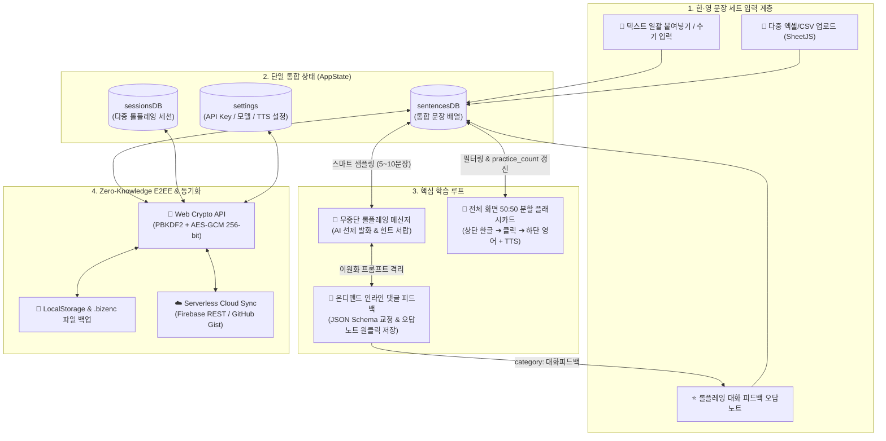

# [Implementation Plan] BizRoleplay: 영어 문장+한국어 세트 기반 롤플레잉 & 플래시카드 웹앱

---

## 1. 사전 영향도 평가 (Pre-Implementation Impact Assessment)

> [!IMPORTANT]
> 워크스페이스 루트(`d:\작업\G Drive\강의 자료\비즈니스 동향 2026\강의 작업\`)에는 기존 실습 파일인 [index.html](file:///d:/작업/G%20Drive/강의%20자료/비즈니스%20동향%202026/강의%20작업/index.html)(오븐하우스 사장 소개) 및 다수의 독립 서브 프로젝트 폴더가 존재함. 기존 파일과의 간섭을 100% 차단하기 위해 전용 하위 디렉터리(`English Practicing App/`)를 신설하여 모든 마크다운 문서 및 앱 파일을 해당 폴더 내에 격리 보관·구현함.

- **기존 기능 간섭 여부:** 없음 (`English Practicing App/index.html` 독립 경로 생성으로 루트 `index.html` 및 타 프로젝트 영향도 0%임)
- **PRD 추가 보완 내역 ([prd.md](file:///c:/Users/USER/Downloads/prd.md) 반영 완료):**
  1. **스마트 텍스트 일괄 붙여넣기(Bulk Text Paste) 파서 추가:** 엑셀/CSV 파일 없이도 공부할 "영어+한국어" 문장 세트를 복사·붙여넣기(`탭`, `|`, `-`, 줄바꿈 교차 인식)하거나 단건 수기 입력할 수 있는 UI/파서 명세 추가함.
  2. **학습 카운트(`practice_count`) 자동 갱신 및 우선순위 샘플링:** 플래시카드 암기 체크 및 롤플레잉 피드백(`target_used: true`, `matched_sentence_id`) 발생 시 `practice_count`를 자동 증가시키고, 미학습·별표 문장을 프롬프트에 우선 주입하도록 보완함.
  3. **음성 입출력(STT/TTS) 및 오프라인 체험 폴백 추가:** Web Speech API 기반 영어 음성 입력(마이크 STT), 원어민 발음 듣기(TTS 배속 조절 `0.8x~1.2x`), API Key 미입력 시 즉시 체험 가능한 스마트 시뮬레이션 폴백 모드를 추가함.

---

## 2. 시스템 아키텍처 및 데이터 흐름 (System Architecture)

---

## 3. 생성 및 수정 대상 파일 (Proposed Changes)

### 3.1 문서 파일
- **[MODIFY] [prd.md](file:///c:/Users/USER/Downloads/prd.md)**
  - 텍스트 일괄 붙여넣기, `practice_count` 갱신 알고리즘, TTS/STT, API 미설정 폴백 등 보완 사항 반영 완료함.
- **[NEW] [prd.md](file:///d:/작업/G%20Drive/강의%20자료/비즈니스%20동향%202026/강의%20작업/English%20Practicing%20App/prd.md)**
  - `English Practicing App` 폴더 내 최신 마스터 PRD 보관함.
- **[NEW] [implementation_plan.md](file:///d:/작업/G%20Drive/강의%20자료/비즈니스%20동향%202026/강의%20작업/English%20Practicing%20App/implementation_plan.md)**
  - `English Practicing App` 폴더 내 구현 계획서 보관함.

### 3.2 애플리케이션 본체 (Single-File Web App)
- **[NEW] `d:\작업\G Drive\강의 자료\비즈니스 동향 2026\강의 작업\English Practicing App\index.html`**
  - 외부 빌드 도구 없이 단일 파일(`index.html`) 내에 HTML5 시맨틱 레이아웃, Tailwind CSS(CDN), Lucide Icons(CDN), SheetJS(CDN), Vanilla JS 모듈을 통합 구현함.

---

## 4. 모듈별 상세 구현 명세 (Detailed Module Breakdown)

### Module 1: 상태 관리 및 초기 온보딩 프리셋 (`StateManager`)
- **단일 상태 트리(`AppState`):**
  - `sentencesDB`: 문장 객체 배열 (`id`, `source_file`, `category`, `korean`, `english`, `notes`, `practice_count`, `is_starred`, `created_at`)
  - `sessionsDB`: 롤플레잉 세션 배열 (`session_id`, `title`, `partner_name`, `partner_persona`, `business_context`, `difficulty`, `target_filter`, `updated_at`, `messages[]`)
  - `activeSessionId`: 현재 선택된 세션 ID
  - `uiState`: 사이드바 열림 상태, 힌트 서랍 토글, 플래시카드 모달 상태(열림 여부, 필터, 현재 인덱스, 하단 정답 노출 단계, 셔플 여부, 출제 방향), 현재 입력창 텍스트 보존값
  - `settings`: LLM 공급자(`gemini` / `openai`), 모델명(`gemini-2.5-flash` 기본), API Key, TTS 속도(`1.0`), E2EE 활성화 여부 및 클라우드 엔드포인트 URL
- **초기 온보딩 샘플 데이터 내장:**
  - 최초 실행 시 빈 화면 방지를 위해 실전 비즈니스 영어 12문장(단가 협상, 일정 조율, 프로젝트 이슈 보고) 및 프리셋 롤플레잉 세션 2개(`A사 바이어 John - Q4 단가 인하 방어`, `글로벌 PM Sarah - 런칭 일정 2주 연기 협의`)를 기본 로드함.

### Module 2: 한·영 문장 세트 멀티 인제스트 및 DB 매니저 (`SentenceIngest & DBModal`)
- **스마트 텍스트 일괄 붙여넣기 (`parseBulkText`):**
  - 사용자가 복사해 붙여넣은 여러 줄의 텍스트에서 구분자(`Tab`, `|`, `-`, `:`, `/`)가 있으면 좌/우를 분리하고, 한글 정규식(`/[가-힣]/`) 포함 비율을 검사해 어느 쪽이 `korean`이고 `english`인지 자동 판별함.
  - 구분자가 없는 경우 연속된 2줄(한글 줄 + 영어 줄, 또는 영어 줄 + 한글 줄)을 한 쌍으로 자동 매칭함.
- **다중 엑셀/CSV 업로드 (`handleExcelUpload`):**
  - `SheetJS` (`XLSX.read`)로 복수 파일을 순회 파싱하며, `UTF-8(65001)` 우선 처리 및 한글 깨짐 감지 시 `TextDecoder('euc-kr')` 폴백을 적용함.
  - 헤더 키워드(`한글/한국어/kr/korean/의미` vs `영어/영문/en/english/표현`) 자동 매핑 및 무헤더 시 데이터 행의 한글 비율로 열 위치를 자동 감지함.
  - 영어 문장 정규화(소문자 및 공백 정리) 비교를 통해 중복 문장은 덮어쓰기/스킵 처리하고 결과를 토스트 메시지로 알림함.
- **문장 DB 관리 모달 & 엑셀 내보내기 (`exportToExcel`):**
  - 카테고리/파일명 필터 조회, 키워드 실시간 검색, 단건 수기 추가, 인라인 텍스트 편집, 별표(`is_starred`) 토글, 선택/개별 삭제 및 `XLSX.writeFile` 기반 `.xlsx` 다운로드 기능 제공함.

### Module 3: 다중 세션 매니저 및 이원화 AI 엔진 (`RoleplayEngine & FeedbackEngine`)
- **다중 세션 프리셋 관리:**
  - 좌측 사이드바에서 세션 전환 시 스크롤 위치 및 대화 내역 즉시 복원함.
  - 세션 생성/수정 모달(파트너 이름/직함, 페르소나, 비즈니스 상황, 난이도 `Beginner/Intermediate/Advanced`, 타깃 문장 세트 필터) 및 `[🔄 현재 대화 비우기]` / `[➕ 새 시나리오 세션]` 분리 제공함.
- **스마트 타깃 샘플링 (`sampleTargetSentences`):**
  - 현재 세션의 `target_filter`에 해당하는 문장 중 `is_starred: true` 및 `practice_count`가 낮은 순으로 정렬하여 상위 8개 문장을 추출, 프롬프트 컨텍스트로 주입함.
- **엔진 1 - 롤플레잉 파트너 호출 (`requestPartnerReply`):**
  - PRD 7.1절의 `Roleplay Engine` 시스템 프롬프트를 엄격히 적용하여 문법 지적이나 제3자 해설을 차단하고 100% 비즈니스 파트너로서만 응답 생성함.
  - `[🎲 AI가 먼저 질문 던지기]` 클릭 시 대화 시작 트리거 프롬프트를 전송하여 파트너가 먼저 비즈니스 이슈와 질문을 던지도록 유도함.
- **엔진 2 - 온디맨드 인라인 댓글 피드백 (`requestMessageFeedback`):**
  - 내 말풍선 우측 하단 `[💬 피드백]` 클릭 시에만 PRD 7.2절의 `Feedback Engine`을 별도 호출함 (`responseMimeType: "application/json"` + `responseSchema` 적용).
  - 이미 생성된 피드백이 있으면 API 재호출 없이 아코디언 스레드를 즉시 토글하며, `[🔄 재분석]` 클릭 시에만 재호출함.
  - 피드백 결과에서 `[✏️ 수정]` 및 `[⭐ 오답노트에 저장]` 클릭 시 `source_file: "chat_feedback"`, `category: "대화피드백"`으로 `sentencesDB`에 즉시 편입함.

### Module 4: 전체 화면 2단계 분할 플래시카드 오버레이 (`FlashcardOverlay`)
- **완벽한 오버레이 격리 (`z-index: 50`):**
  - 진입 전 메인 채팅창의 스크롤 위치와 입력창 텍스트를 보존하고, `[✕ Exit]` 또는 `ESC` 입력 시 즉시 원상 복귀함.
- **상·하단 50:50 분할 2단계 인출(Retrieval) UI:**
  - **상단 50%:** 학습할 한글 문장(또는 `영➔한` 전환 시 영어 문장)과 카테고리/출처 배지, 진행률 바 표시함.
  - **하단 50%:**
    - `Step 1 (Hidden)`: 블러/가림막 디자인과 함께 *"화면을 클릭(탭)하거나 Space바를 눌러 영어 정답 확인"* 안내 노출함.
    - `Step 2 (Revealed)`: 정답 영어 문장, 메모(`notes`), `[🔊 발음 듣기 (TTS)]`, `[✅ 암기 완료 (practice_count +1)]`, `[★ 중요 별표]` 버튼 노출함.
- **키보드 단축키 바인딩:**
  - `Space` / `Enter` (정답 확인 및 다음 카드 진행), `←` / `→` (이전/다음 카드), `S` (TTS 발음 재생), `B` (별표 토글), `ESC` (종료) 지원함.

### Module 5: Zero-Knowledge E2EE 보안 및 클라우드/파일 동기화 (`CryptoSyncManager`)
- **Web Crypto API 암·복호화 파이프라인:**
  - `deriveKey(passcode, salt)`: `PBKDF2` (`SHA-256`, `100,000` iterations)로 `AES-GCM 256-bit` 키 파생함.
  - `encryptAppState(state, passcode)` / `decryptAppState(payload, passcode)`:隨機 `salt(16B)` 및 `iv(12B)`를 생성하여 `Base64` 인코딩된 `{ version, encrypted: true, salt, iv, ciphertext, updated_at }` JSON 페이로드 생성함.
- **3중 백업 및 동기화:**
  1. **LocalStorage 자동 캐싱:** 상태 변경 시 디바운싱 저장(Passcode 설정 시 암호문 저장, 미설정 시 빠른 시작 평문 저장).
  2. **클라우드 REST 동기화:** Firebase Realtime Database URL(`https://...firebaseio.com/bizroleplay.json`) 또는 GitHub Gist API를 통해 암호문 페이로드를 `PUT(Push)` / `GET(Pull)` 동기화함.
  3. **암호화 파일 Import/Export:** `.bizenc.json` 파일 다운로드 및 업로드 복원 기능 제공함.

---

## 5. 구문 무결성 및 검증 계획 (Verification Plan)

1. **구문 및 태그 무결성 검증:**
   - HTML 닫는 태그 누락 여부, JavaScript 스크립트 블록 문법 오류(괄호쌍, 비동기 `try-catch` 누락) 정적 검증 수행함.
2. **핵심 유저 플로우 시뮬레이션 검증:**
   - **문장 입력 검증:** 텍스트 일괄 붙여넣기(한+영 세트) 및 엑셀/CSV 업로드 시 `sentencesDB` 정상 병합 및 중복 제거 확인함.
   - **롤플레잉 & 피드백 검증:** `[🎲 AI가 먼저 질문 던지기]` 동작, 사용자 영어 답변 전송, `[💬 피드백]` 아코디언 오픈 및 `[⭐ 오답노트에 저장]` 클릭 시 `대화피드백` 카테고리 반영 확인함.
   - **플래시카드 검증:** `[🎴 플래시카드]` 모달 진입, 상단 50% 한글 노출 ➔ 클릭/Space ➔ 하단 50% 영문 및 TTS 작동 ➔ `[✕ Exit]` 클릭 시 기존 대화창 완벽 복귀 확인함.
   - **E2EE 암·복호화 검증:** 마스터 Passcode로 암호화 백업 후 복호화 시 원본 `AppState`와 100% 일치하는지 검증함.
